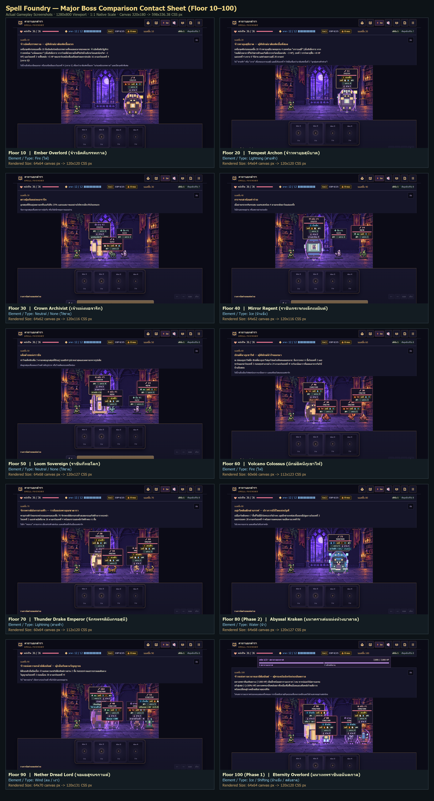

# Spell Foundry — Major Boss Visual Audit (Floor 10–100)

เอกสารนี้เป็นการตรวจสอบดีไซน์ รูปลักษณ์ และการแสดงผลจริงใน Gameplay ของ **Major Boss ทั้ง 10 ตัว** (Floor 10, 20, 30, 40, 50, 60, 70, 80, 90 และ 100) อ้างอิงจาก Source Code ปัจจุบันใน `spell-foundry-merged-floors-5-8/` เท่านั้น (Read-Only Audit ไม่มีการแก้ไขโค้ดเกมหรือ Asset เดิม)

---

## ภาพรวมเปรียบเทียบ (Boss Comparison Contact Sheet)

- **ไฟล์ Contact Sheet:** `major-boss-visual-audit/boss-comparison-contact-sheet.png` (`2668 × 4926 px`, เรียง 2 Columns × 5 Rows, รักษา Aspect Ratio 1:1 จากภาพ Gameplay ขนาด `1280 × 800 px`)
- **ความละเอียด Canvas ภายในเกม:** `320 × 180 px` (ขยายด้วย CSS `image-rendering: pixelated` เป็น `598 × 336.38 px` บน Viewport `1280 × 800`, อัตราส่วนขยาย `1.86875×`)
- **ขนาด Player (`wizard`) สำหรับเปรียบเทียบ:** `32 × 32` grid @ `1×` = `32 × 32` canvas px (ประมาณ `60 × 60` CSS px)

---

## ตารางสรุปข้อมูล Major Boss (Floor 10–100)

| Floor | Room | Boss Name (EN / TH) | Boss ID | Element / Type | Native Sprite (Canvas px) | Rendered Size (CSS px) | Phase / Transformation |
|---:|---:|---|---|---|---|---|---|
| **10** | 24 | Ember Overlord / จ้าวอัคคีบรรพกาล | `ember_overlord` | Fire (`fire`) | `64 × 64` (`32×32` @ 2×) | `120 × 120` | 1 Phase (4-turn cycle) |
| **20** | 49 | Tempest Archon / จ้าวพายุอสุนีบาต | `tempest_archon` | Lightning (`lightning`) | `64 × 64` (`32×32` @ 2×) | `120 × 120` | 1 Phase (4-turn cycle) |
| **30** | 74 | Crown Archivist / เจ้าแห่งหอจารึก | `crown_archivist` | Neutral / None | `64 × 62` (`32×31` @ 2×) | `120 × 116` | 1 Phase (Minion Guard −25%) |
| **40** | 99 | Mirror Regent / ราชันกระจกผลึกเหมันต์ | `mirror_regent` | Ice (`ice`) | `64 × 62` (`32×31` @ 2×) | `120 × 116` | 1 Phase (Mirror Ward Reflect 4) |
| **50** | 124 | Loom Sovereign / ราชันกี่ทอโลก | `loom_sovereign` | Neutral / None | `64 × 68` (`32×34` @ 2×) | `120 × 127` | 1 Phase (Repeat Reduction 70%) |
| **60** | 149 | Volcano Colossus / ยักษ์อัคนีภูเขาไฟ | `volcano_colossus` | Fire (`fire`) | `60 × 66` (`30×33` @ 2×) | `112 × 123` | 1 Phase (Magma Armor + 4-turn cycle) |
| **70** | 174 | Thunder Drake Emperor / จักรพรรดิมังกรอสุนี | `thunder_drake_emperor` | Lightning (`lightning`) | `60 × 64` (`30×32` @ 2×) | `112 × 120` | 1 Phase (Star Static 4 + Grounded) |
| **80** | 199 | Abyssal Kraken / มหาคราเค่นแห่งห้วงบาดาล | `abyssal_kraken` | Water (`water`) | `64 × 68` (`32×34` @ 2×) | `120 × 127` | **2 Phases**: P1 หนวด 4 เส้น → P2 ร่างจริง |
| **90** | 224 | Nether Dread Lord / จอมอสูรนรกานต์ | `nether_dread_lord` | Wind (`wind`) | `64 × 70` (`32×35` @ 2×) | `120 × 131` | **2 Phases**: P1 พันธสัญญา 3 เสา → P2 ปลดผนึก |
| **100** | 249 | Eternity Overlord / มหาเทพราชันอนันตกาล Eternity Reborn / ร่างจุตินิรันดร์ | `eternity_overlord` `eternity_reborn` | Ice → Shifting Fire → Shifting | `64 × 64` (`32×32` @ 2×) `72 × 74` (`36×37` @ 2×) | `120 × 120` `135 × 138` | **3 Phases**: P1 สภา → P2 สลับธาตุ → P3 `eternity_reborn` |

---

## รายละเอียดบอสแต่ละตัว (Individual Boss Visual Reference)

### 1. Floor 10 — Ember Overlord (จ้าวอัคคีบรรพกาล)

- **Floor / Room:** Floor 10 (`room 24`, `FLOOR10_BOSS_ROOM`)
- **Boss Name:** Ember Overlord / จ้าวอัคคีบรรพกาล
- **Boss ID:** `ember_overlord`
- **Element / Type:** Fire (`fire`) · Major Boss (`isBoss: true`, `LARGE_BOSS_KINDS`, `MAJOR_BOSS_KINDS`)
- **Stats พื้นฐาน:** HP `135`, Armor `3`, Ward `1`, Base Attack `8`
- **ลักษณะรูปร่างและองค์ประกอบการออกแบบ:**
  - อัศวิน/จอมเวทเกราะหนักทรงสี่เหลี่ยม วาดแบบ Procedural Pixel Rectangles ใน `src/render.js`
  - สวมมงกุฎเปลวไฟ 5 แฉก พร้อมเขา 2 ข้าง, หมวกเกราะมี Visor สีดำและตาเรืองแสงสี่เหลี่ยม 2 ดวง
  - เกราะอกมีแกนแมกมาสี่เหลี่ยมตรงกลาง, ไหล่มี Pauldron สีทอง, แขน 2 ข้างสวมถุงมือเกราะ, ถือคทาหัวคบเพลิงแมกมาด้านขวา
- **สีหลักและ Visual Theme:** น้ำตาลเข้ม/ดำ (`#332d2b`, `#10191b`), แดงเลือดหมู/ส้มอิฐ (`#4d3036`, `#7b464c`), ทอง/เหลืองสว่าง (`#e4b659`, `#f5db87`), Accent `color: '#ffad42'`
- **ขนาด Sprite ต้นฉบับ:** `64 × 64` canvas px (`32 × 32` grid @ `2×` scale)
- **ขนาดที่แสดงผลจริงใน Gameplay:** `120 × 120` CSS px (บน Canvas `598 × 336.38`)
- **ความสามารถหลักและ Combat Mechanics:**
  - **เกล็ดแมกมา (Magma Scales):** เมื่อยังมี Armor หากถูกโจมตีด้วยธาตุอื่นที่ไม่ใช่ Ice (`ice`) จะสะท้อนไฟ `2` ดาเมจ (`ember-thorns`)
  - **4-Turn Cycle:** Turn 2 โจมตี `10`, Turn 3 ชาร์จพร้อมฟื้น `+5 HP`, Turn 4 ปลดปล่อยท่าใหญ่ `16` ดาเมจ
- **Phase / Transformation:** ไม่มี Phase แยก
- **Visual Effects & Animation:** เปลวไฟบนมงกุฎกระพริบสลับ (`flicker = frame % 2`), แกนกลางอกสลับสีทอง/ขาว, สะเก็ดไฟลอยด้านข้าง 2 จุด, ท่า Charge มีเสาไฟพุ่งจากพื้นและวงรีไฟใต้เท้า
- **ไฟล์ภาพอ้างอิง:**
  - Gameplay: [floor-10-ember-overlord.png](gameplay/floor-10-ember-overlord.png)
  - Sprite Native: [floor-10-ember-overlord-native.png](sprites/floor-10-ember-overlord-native.png)
  - Sprite 4× Nearest-neighbor: [floor-10-ember-overlord-4x.png](sprites/floor-10-ember-overlord-4x.png)

---

### 2. Floor 20 — Tempest Archon (จ้าวพายุอสุนีบาต)

- **Floor / Room:** Floor 20 (`room 49`, `FLOOR20_BOSS_ROOM`)
- **Boss Name:** Tempest Archon / จ้าวพายุอสุนีบาต
- **Boss ID:** `tempest_archon`
- **Element / Type:** Lightning (`lightning`) · Major Boss
- **Stats พื้นฐาน:** HP `255`, Armor `4`, Ward `1`, Base Attack `11`
- **ลักษณะรูปร่างและองค์ประกอบการออกแบบ:**
  - ใช้โครงสร้างและสัดส่วนแทบเหมือน `ember_overlord` ทุกประการใน `src/render.js` (มงกุฎ 5 แฉก, หมวกเกราะ Visor, แกนกลางอกสี่เหลี่ยม, Pauldron ไหล่, ถุงมือ, ขา 2 ข้าง, คทาด้านขวา)
  - จุดต่างหลักคือเพิ่มแถบปีกสายฟ้าแนวตั้งข้างลำตัว 2 ข้าง และเปลี่ยนจานสีเป็นม่วงคราม/มิ้นต์/เหลืองสายฟ้า
- **สีหลักและ Visual Theme:** ม่วงเข้ม/เทาคราม (`#3d374e`, `#60516f`, `#907ba6`), เขียวมิ้นต์สว่าง (`#b7d9bd`), ทอง/เหลืองสายฟ้า (`#f5db87`, `#eff0c4`), Accent `color: '#ffe53b'`
- **ขนาด Sprite ต้นฉบับ:** `64 × 64` canvas px (`32 × 32` grid @ `2×` scale)
- **ขนาดที่แสดงผลจริงใน Gameplay:** `120 × 120` CSS px
- **ความสามารถหลักและ Combat Mechanics:**
  - **ประจุอัสนี (Storm Static):** เมื่อยังมี Armor หากถูกโจมตีด้วยธาตุอื่นที่ไม่ใช่ Lightning (`lightning`) และไม่ใช่ `pierce` จะช็อตคืน `3` ดาเมจ (`storm-static`)
  - **4-Turn Cycle:** Turn 2 โจมตี `14`, Turn 3 ชาร์จพร้อมฟื้น `+8 HP`, Turn 4 ปลดปล่อย **อสุนีพิพากษา** `20` ดาเมจ
- **Phase / Transformation:** ไม่มี Phase แยก
- **Visual Effects & Animation:** มงกุฎและปีกสายฟ้าสั่นสลับเฟรม (`spark = frame % 2`), สะเก็ดไฟฟ้าลอยด้านข้าง, ท่า Charge มีสายฟ้าผ่าลงมาจากด้านบน (`pixelBolt`)
- **ไฟล์ภาพอ้างอิง:**
  - Gameplay: [floor-20-tempest-archon.png](gameplay/floor-20-tempest-archon.png)
  - Sprite Native: [floor-20-tempest-archon-native.png](sprites/floor-20-tempest-archon-native.png)
  - Sprite 4× Nearest-neighbor: [floor-20-tempest-archon-4x.png](sprites/floor-20-tempest-archon-4x.png)

---

### 3. Floor 30 — Crown Archivist (เจ้าแห่งหอจารึก)

- **Floor / Room:** Floor 30 (`room 74`, `FLOOR30_BOSS_ROOM`)
- **Boss Name:** Crown Archivist / เจ้าแห่งหอจารึก
- **Boss ID:** `crown_archivist`
- **Element / Type:** Neutral / None (ไร้ธาตุ) · Major Boss
- **Stats พื้นฐาน:** HP `235`, Armor `3`, Ward `2`, Base Attack `13` (เปิดศึกพร้อมลูกสมุน `rune_ram`, `ward_scribe`)
- **ลักษณะรูปร่างและองค์ประกอบการออกแบบ:**
  - จอมเวทผู้ทรงภูมิสวมเสื้อคลุมยาวสีเข้มคาดผ้าคลุม/สายสะพายสีทองแนวตั้งตรงกลาง (`middle-sprites.js`)
  - สวมมงกุฎทอง 3 ยอดบนศีรษะ, มีปีก/ผ้าคลุมแสงสีม่วง-เหลืองกางออกสองข้าง, และมีแผ่นจารึกรูน 2 แผ่นลอยขนาบซ้ายขวา
- **สีหลักและ Visual Theme:** ม่วงเข้ม/น้ำตาลทอง/เหลืองสว่าง (`#3d374e`, `#907ba6`, `#d3aa6b`, `#f5db87`, `#eff0c4`), Accent `color: '#ffd18e'`
- **ขนาด Sprite ต้นฉบับ:** `64 × 62` canvas px (`32 × 31` grid @ `2×` scale)
- **ขนาดที่แสดงผลจริงใน Gameplay:** `120 × 116` CSS px
- **ความสามารถหลักและ Combat Mechanics:**
  - **ตราคุ้มกัน (Guarded by Allies):** ตราบใดที่ลูกสมุนในห้องยังมีชีวิต ดาเมจที่บอสได้รับลดลง `25%`
  - **Support & Heavy Cycle:** วัฏจักร 3 เทิร์น (กางม่านให้เพื่อน +1 ชั้น & ชาร์จ → ทุบ `20` → เปิดช่องรับดาเมจ `recover`)
- **Phase / Transformation:** ไม่มี Phase แยก
- **Visual Effects & Animation:** ปีกและแผ่นจารึกรูนลอยขึ้นลงตาม `floatY` และกระพริบแสงสีทอง (`light`)
- **ไฟล์ภาพอ้างอิง:**
  - Gameplay: [floor-30-crown-archivist.png](gameplay/floor-30-crown-archivist.png)
  - Sprite Native: [floor-30-crown-archivist-native.png](sprites/floor-30-crown-archivist-native.png)
  - Sprite 4× Nearest-neighbor: [floor-30-crown-archivist-4x.png](sprites/floor-30-crown-archivist-4x.png)

---

### 4. Floor 40 — Mirror Regent (ราชันกระจกผลึกเหมันต์)

- **Floor / Room:** Floor 40 (`room 99`, `FLOOR40_BOSS_ROOM`)
- **Boss Name:** Mirror Regent / ราชันกระจกผลึกเหมันต์
- **Boss ID:** `mirror_regent`
- **Element / Type:** Ice (`ice`) · Rift Major Boss
- **Stats พื้นฐาน:** HP `325`, Armor `3`, Ward `2`, Base Attack `14`, Heavy `28` (พร้อม `ward_scribe`, `thread_archer`)
- **ลักษณะรูปร่างและองค์ประกอบการออกแบบ:**
  - รูปทรงเรขาคณิตแบบกระจกเงาสี่เหลี่ยมกรอบหนา (`middle-sprites.js`) มียอดผลึกด้านบนและฐานตั้งด้านล่าง
  - ภายในกรอบกระจกมีริ้วแสงสะท้อนเฉียง/แนวตั้ง และมีใบหน้า/ดวงตาสีทองเล็กๆ 2 ดวงซ่อนอยู่ตรงกลาง
  - มีเศษผลึก 2 ชิ้นลอยขนาบด้านซ้ายและขวา
- **สีหลักและ Visual Theme:** กรอบม่วงเข้ม/น้ำเงินคราม (`#3d374e`, `#577bc2`), พื้นกระจกเขียวมิ้นต์/ฟ้าอ่อน (`#53857b`, `#8bb7a0`, `#bdd9ff`), Accent `color: '#95c7e6'`
- **ขนาด Sprite ต้นฉบับ:** `64 × 62` canvas px (`32 × 31` grid @ `2×` scale)
- **ขนาดที่แสดงผลจริงใน Gameplay:** `120 × 116` CSS px
- **ความสามารถหลักและ Combat Mechanics:**
  - **ม่านกระจกสะท้อน (Mirror Ward):** เมื่อ Ward กันกระสุน (Projectile ที่ไม่ใช่ Beam) จะสะท้อน `4` ดาเมจกลับผู้เล่น (`mirror-reflect`)
  - **Rift Cycle:** สลับตำแหน่ง (`swapTurn: 1`), กางม่านทุกเทิร์น (`wardTurn: 1`), ท่าหนัก `28`, และเปิดช่อง +35% ในเทิร์นที่ `turn % 3 === 0`
- **Phase / Transformation:** ไม่มี Phase แยก
- **Visual Effects & Animation:** เศษผลึกซ้ายขวาขยับขึ้นลง (`flare`)
- **ไฟล์ภาพอ้างอิง:**
  - Gameplay: [floor-40-mirror-regent.png](gameplay/floor-40-mirror-regent.png)
  - Sprite Native: [floor-40-mirror-regent-native.png](sprites/floor-40-mirror-regent-native.png)
  - Sprite 4× Nearest-neighbor: [floor-40-mirror-regent-4x.png](sprites/floor-40-mirror-regent-4x.png)

---

### 5. Floor 50 — Loom Sovereign (ราชันกี่ทอโลก)

- **Floor / Room:** Floor 50 (`room 124`, `FLOOR50_BOSS_ROOM`)
- **Boss Name:** Loom Sovereign / ราชันกี่ทอโลก
- **Boss ID:** `loom_sovereign`
- **Element / Type:** Neutral / None (ไร้ธาตุ) · Rift Major Boss
- **Stats พื้นฐาน:** HP `530`, Armor `4`, Ward `2`, Base Attack `19`, Heavy `36`, `repeatReduction: 70` (พร้อม `rift_runner`, `ward_scribe`, `thread_archer`)
- **ลักษณะรูปร่างและองค์ประกอบการออกแบบ:**
  - จอมราชันในชุดคลุมม่วง-ทอง ลอยอยู่กลาง **กรอบกี่ทอผ้าขนาดใหญ่ (World Loom Frame)** ที่ตั้งตระหง่านด้านหลัง พร้อมเส้นด้ายแห่งความจริง 4 เส้นขึงแนวตั้ง
  - สวมมงกุฎทอง มีกระสวยทอผ้า (Loom Shuttles) 4 อันลอยขนาบซ้ายขวา
- **สีหลักและ Visual Theme:** กรอบไม้สีน้ำตาล/ทอง (`#765740`, `#d3aa6b`), ชุดคลุมม่วงเข้ม/ชมพูอมม่วง (`#3d374e`, `#985cab`, `#efbeff`), ทอง/ขาวสว่าง, Accent `color: '#ddccfb'`
- **ขนาด Sprite ต้นฉบับ:** `64 × 68` canvas px (`32 × 34` grid @ `2×` scale)
- **ขนาดที่แสดงผลจริงใน Gameplay:** `120 × 127` CSS px
- **ความสามารถหลักและ Combat Mechanics:**
  - **จำรูปเวท (`repeatReduction: 70`):** ร่ายเวททรงเดิมซ้ำลดดาเมจ `70%` (ยกเว้นเทิร์นเปิดช่อง `turn % 3 === 0` +35%)
  - **ท่าหนักเสริมพลังตามลูกสมุน:** รอบ `turn % 3 === 2` ท่าหนัก `36` บวกเพิ่ม `+3` ดาเมจต่อลูกสมุนที่ยังมีชีวิต
- **Phase / Transformation:** ไม่มี Phase แยก
- **Visual Effects & Animation:** ร่างลอยขึ้นลงตาม `floatY`, เส้นด้ายและกระสวยกระพริบสลับสี, ท่าโจมตีมีแสงเส้นด้ายระเบิดแนวนอน
- **ไฟล์ภาพอ้างอิง:**
  - Gameplay: [floor-50-loom-sovereign.png](gameplay/floor-50-loom-sovereign.png)
  - Sprite Native: [floor-50-loom-sovereign-native.png](sprites/floor-50-loom-sovereign-native.png)
  - Sprite 4× Nearest-neighbor: [floor-50-loom-sovereign-4x.png](sprites/floor-50-loom-sovereign-4x.png)

---

### 6. Floor 60 — Volcano Colossus (ยักษ์อัคนีภูเขาไฟ)

- **Floor / Room:** Floor 60 (`room 149`, `FLOOR60_BOSS_ROOM`)
- **Boss Name:** Volcano Colossus / ยักษ์อัคนีภูเขาไฟ
- **Boss ID:** `volcano_colossus`
- **Element / Type:** Fire (`fire`) · Endgame Major Boss
- **Stats พื้นฐาน:** HP `1500`, Armor `3`, Ward `1`, Base Attack `46` (พร้อม `magma_tortoise` ×2, `cinder_drake`)
- **ลักษณะรูปร่างและองค์ประกอบการออกแบบ:**
  - ยักษ์ศิลาทรงสี่เหลี่ยมล่ำสัน (`middle-sprites.js`) บนศีรษะมีปล่องภูเขาไฟขนาดเล็กพ่นลาวาสีส้ม-ทอง
  - กลางอกมีรอยแยกแมกมารูปกากบาทสีทองสว่าง, ไหล่สองข้างมีเบ้าแมกมา, แขน/กำปั้นขนาดใหญ่
- **สีหลักและ Visual Theme:** หินภูเขาไฟสีน้ำตาลเข้ม/ดำ (`#332d2b`, `#514036`, `#765740`), ลาวา/แมกมาสีแดงอิฐ/ทอง (`#b46c67`, `#ffd179`, `#f5db87`), Accent `color: '#e63946'`
- **ขนาด Sprite ต้นฉบับ:** `60 × 66` canvas px (`30 × 33` grid @ `2×` scale)
- **ขนาดที่แสดงผลจริงใน Gameplay:** `112 × 123` CSS px
- **ความสามารถหลักและ Combat Mechanics:**
  - **เกราะแมกมา:** ใช้น้ำ (`water`) หรือน้ำแข็ง (`ice`) ดับเกราะลด `-2` ได้
  - **4-Turn Cycle:** Turn 2 โจมตี `38`, Turn 3 ชาร์จเตรียมทุบ `68`, Turn 4 ปลดปล่อย **ภูเขาไฟพิโรธ** `68` ดาเมจ + เปิดช่อง `+35%`
- **Phase / Transformation:** ไม่มี Phase แยก
- **Visual Effects & Animation:** แกนแมกมากลางอกและไหล่กระพริบสลับสี, ท่าโจมตียกแขนทุบพื้นเกิดคลื่นปะทุแนวนอน
- **ไฟล์ภาพอ้างอิง:**
  - Gameplay: [floor-60-volcano-colossus.png](gameplay/floor-60-volcano-colossus.png)
  - Sprite Native: [floor-60-volcano-colossus-native.png](sprites/floor-60-volcano-colossus-native.png)
  - Sprite 4× Nearest-neighbor: [floor-60-volcano-colossus-4x.png](sprites/floor-60-volcano-colossus-4x.png)

---

### 7. Floor 70 — Thunder Drake Emperor (จักรพรรดิมังกรอสุนี)

- **Floor / Room:** Floor 70 (`room 174`, `FLOOR70_BOSS_ROOM`)
- **Boss Name:** Thunder Drake Emperor / จักรพรรดิมังกรอสุนี
- **Boss ID:** `thunder_drake_emperor`
- **Element / Type:** Lightning (`lightning`) · Endgame Major Boss
- **Stats พื้นฐาน:** HP `2800`, Armor `5`, Ward `1`, Base Attack `58` (พร้อม `sand_stalker` ×2, `spark_wraith`)
- **ลักษณะรูปร่างและองค์ประกอบการออกแบบ:**
  - รูปร่างคล้ายนักรบมังกรสวมเกราะยืนสองขา (`middle-sprites.js`) มีเขาสายฟ้า 2 ข้างบนหัว, ปีกสี่เหลี่ยมขนาดใหญ่ด้านข้าง, แกนพลังงานสี่เหลี่ยมกลางอก, กำปั้น 2 ข้างถือลูกแก้วสายฟ้า
- **สีหลักและ Visual Theme:** น้ำตาลทอง/สัมฤทธิ์ (`#332d2b`, `#765740`, `#a57a50`), ทอง/เหลืองสายฟ้า (`#e4b659`, `#f5db87`, `#fff3a1`), Accent `color: '#ffb703'`
- **ขนาด Sprite ต้นฉบับ:** `60 × 64` canvas px (`30 × 32` grid @ `2×` scale)
- **ขนาดที่แสดงผลจริงใน Gameplay:** `112 × 120` CSS px
- **ความสามารถหลักและ Combat Mechanics:**
  - **เกราะมหาประจุดารา:** เมื่อมีเกราะ จะสะท้อนสายฟ้า `4` ดาเมจต่อฮิต ยกเว้นใช้ธาตุดิน (`earth` ทำให้ติดสถานะลงกราวด์ `groundedUntil`) หรือคำว่า `pierce`
  - **4-Turn Cycle:** Turn 2 โจมตี `48`, Turn 3 ชาร์จ, Turn 4 ฟาดสายฟ้า `84` ดาเมจ + เปิดช่อง `+35%`
- **Phase / Transformation:** ไม่มี Phase แยก
- **Visual Effects & Animation:** เขาสายฟ้า ปีก แกนกลาง และลูกแก้วกระพริบสลับสีทอง/เหลือง, ท่าโจมตียิงคลื่นสายฟ้าแนวนอน
- **ไฟล์ภาพอ้างอิง:**
  - Gameplay: [floor-70-thunder-drake-emperor.png](gameplay/floor-70-thunder-drake-emperor.png)
  - Sprite Native: [floor-70-thunder-drake-emperor-native.png](sprites/floor-70-thunder-drake-emperor-native.png)
  - Sprite 4× Nearest-neighbor: [floor-70-thunder-drake-emperor-4x.png](sprites/floor-70-thunder-drake-emperor-4x.png)

---

### 8. Floor 80 — Abyssal Kraken (มหาคราเค่นแห่งห้วงบาดาล)

- **Floor / Room:** Floor 80 (`room 199`, `FLOOR80_BOSS_ROOM`)
- **Boss Name:** Abyssal Kraken / มหาคราเค่นแห่งห้วงบาดาล
- **Boss ID:** Phase 1: `kraken_ward_tentacle`, `kraken_heal_tentacle`, `kraken_ink_tentacle`, `kraken_crush_tentacle` → Phase 2: `abyssal_kraken`
- **Element / Type:** Water (`water`) · Endgame Major Boss
- **Stats พื้นฐาน:** Phase 1 หนวด 4 เส้น (HP `950–1250` ต่อเส้น) → Phase 2 ร่างจริง HP `4600`, Armor `5`, Ward `1`, Base Attack `72`
- **ลักษณะรูปร่างและองค์ประกอบการออกแบบ:**
  - **Phase 1:** หนวดปลาหมึกยักษ์ 4 เส้นเรียงเต็มสนาม แต่ละเส้นมีรูปทรงและสี/หน้าที่ต่างกัน (ม่าน/ฮีล/หมึกดำ/บดขยี้)
  - **Phase 2 (`abyssal_kraken`):** ส่วนหัวขนาดมหึมาของคราเค่น มีครีบมงกุฎทะเลกางออกสองข้าง, จุดเรืองแสงชีวภาพ, ตานักล่าสีทองเรืองแสง, จะงอยปากมีเขี้ยว 2 ซี่, พร้อมหนวดรอง 4 เส้นขนาบข้างบนฐานคลื่นน้ำวน
- **สีหลักและ Visual Theme:** เขียวอมน้ำเงินบาดาล/ฟ้าคราม (`#203033`, `#335250`, `#347fae`, `#adf7ff`), เขียวมิ้นต์ (`#b7d9bd`), ตาสีทอง (`#f5db87`), Accent `color: '#0077b6'`
- **ขนาด Sprite ต้นฉบับ:** `64 × 68` canvas px (`32 × 34` grid @ `2×` scale)
- **ขนาดที่แสดงผลจริงใน Gameplay:** `120 × 127` CSS px
- **ความสามารถหลักและ Combat Mechanics:**
  - **2-Phase Encounter:** ต้องปราบหนวดทั้ง 4 เส้นใน Phase 1 ก่อน จึงจะเรียก `abyssal_kraken` ร่างจริงออกมาใน Phase 2
  - **ผิวน้ำบาดาลนำไฟฟ้า:** โดนธาตุ Lightning เพิ่ม `+15` ดาเมจแท้และลด Armor `-2` (`abyssalShockUntil`)
  - **4-Turn Cycle:** Turn 2 ฟื้น `+120 HP` + โจมตี `58`, Turn 3 ชาร์จ, Turn 4 **มหาคลื่นสึนามิบาดาล** `108` ดาเมจ + เปิดช่อง `+35%`
- **Phase / Transformation:** มีการเปลี่ยน Phase ที่เปลี่ยนศัตรูในฉากอย่างชัดเจน (หนวด 4 เส้น → ร่างจริง `abyssal_kraken`) พร้อม VFX คลื่นทะเลท่วมจอ (`boss-phase`)
- **Visual Effects & Animation:** ตัวบอสและฐานคลื่นน้ำวนขยับขึ้นลง (`floatY`, `waveShift`), ดวงตากระพริบเรืองแสง
- **ไฟล์ภาพอ้างอิง:**
  - Gameplay (Phase 2 ร่างจริง): [floor-80-abyssal-kraken.png](gameplay/floor-80-abyssal-kraken.png)
  - Phase 1 (หนวด 4 เส้น): [floor-80-abyssal-kraken-phase1-tentacles.png](phases/floor-80-abyssal-kraken-phase1-tentacles.png)
  - Sprite Native: [floor-80-abyssal-kraken-native.png](sprites/floor-80-abyssal-kraken-native.png)
  - Sprite 4× Nearest-neighbor: [floor-80-abyssal-kraken-4x.png](sprites/floor-80-abyssal-kraken-4x.png)

---

### 9. Floor 90 — Nether Dread Lord (จอมอสูรนรกานต์)

- **Floor / Room:** Floor 90 (`room 224`, `FLOOR90_BOSS_ROOM`)
- **Boss Name:** Nether Dread Lord / จอมอสูรนรกานต์
- **Boss ID:** `nether_dread_lord` (พร้อมเสา 3 ต้น: `nether_leech_pillar`, `nether_curse_pillar`, `nether_doom_pillar`)
- **Element / Type:** Wind (`wind` ในข้อมูล Code, ธีม Void/Shadow) · Endgame Major Boss
- **Stats พื้นฐาน:** HP `7000`, Armor `5`, Ward `2`, Base Attack `84`, `repeatReduction: 70`
- **ลักษณะรูปร่างและองค์ประกอบการออกแบบ:**
  - จอมปีศาจเกราะมืด มีเขาโค้งสีแดงเลือดหมูขนาดใหญ่ 2 ข้าง, ปีกเงาขนาดกว้าง, แกนวิญญาณสีแดงกลางอก, กรงเล็บ 2 ข้าง, และขา 2 ข้าง (`middle-sprites.js`)
  - ยืนร่วมกับเสาอาคม 3 ต้น (`leech`, `curse`, `doom`) ที่มีดีไซน์เสาหินออบซิเดียนต่างสีกัน
- **สีหลักและ Visual Theme:** ม่วงดำ/เงามืด (`#3d374e`, `#9253ae`, `#e4b6ff`), แดงเลือดหมู (`#7b464c`, `#b46c67`), Accent `color: '#240046'`
- **ขนาด Sprite ต้นฉบับ:** `64 × 70` canvas px (`32 × 35` grid @ `2×` scale)
- **ขนาดที่แสดงผลจริงใน Gameplay:** `120 × 131` CSS px
- **ความสามารถหลักและ Combat Mechanics:**
  - **พันธสัญญาสามเสา (Tri-Pillar Pact):** เสาที่เหลือแต่ละต้นลดดาเมจบอส `-25%` (สูงสุด `-75%`); หากบอส HP ≤ 50% ขณะเสายังอยู่ จะสังเวยเสาฟื้น `+350 HP/ต้น` และเข้าโหมดปลดผนึก (`netherPhase = 2`)
  - **โหมดปลดผนึก:** โจมตีทะลุโล่จะสูบเลือด `+150 HP`; ใช้ Fire หรือ Lightning เพื่อ **ชำระมลทิน** ปิดสูบเลือดและลดเกราะ `-2`
- **Phase / Transformation:** Phase 2 (`netherPhase = 2`) เป็นการเปลี่ยนโหมดกลไก/สังเวยเสา ตัว Sprite ของ `nether_dread_lord` ยังคงใช้ร่างเดิม (ไม่ได้เปลี่ยน Sprite)
- **Visual Effects & Animation:** มี VFX คลื่นมืด/ความตายตอนเข้า Phase 2 (`boss-phase`) และคลื่นเปลวเพลิงนรกานต์ตอนโจมตีท่าใหญ่ `128` ดาเมจ
- **ไฟล์ภาพอ้างอิง:**
  - Gameplay: [floor-90-nether-dread-lord.png](gameplay/floor-90-nether-dread-lord.png)
  - Sprite Native: [floor-90-nether-dread-lord-native.png](sprites/floor-90-nether-dread-lord-native.png)
  - Sprite 4× Nearest-neighbor: [floor-90-nether-dread-lord-4x.png](sprites/floor-90-nether-dread-lord-4x.png)

---

### 10. Floor 100 — Eternity Overlord / Eternity Reborn (มหาเทพราชันอนันตกาล)

- **Floor / Room:** Floor 100 (`room 249`, `FLOOR100_BOSS_ROOM`)
- **Boss Name:**
  - Phase 1–2: Eternity Overlord / มหาเทพราชันอนันตกาล (`eternity_overlord`)
  - Phase 3: Eternity Reborn / มหาเทพอนันตกาล · ร่างจุตินิรันดร์ (`eternity_reborn`)
- **Element / Type:**
  - Phase 1: Ice (`ice`) · Phase 2: สลับธาตุทุกเทิร์น (`earth` → `fire` → `ice` → `lightning`) · Phase 3: Fire (`fire`) + สลับธาตุ
- **Stats พื้นฐาน:** Phase 1–2 HP `7000` (`3500 + 3500`), Armor `6`, Ward `2`, ATK `98` → Phase 3 HP `4500`, Armor `6`, Ward `2`, ATK `124`, `repeatReduction: 75` (P1–2) / `50` (P3)
- **ลักษณะรูปร่างและองค์ประกอบการออกแบบ:**
  - **Phase 1–2 (`eternity_overlord`):** เทพเจ้าสวมชุดคลุมม่วง-ทอง คาดแถบทองแนวตั้ง มีรัศมีวงแหวนทอง 3 ชั้นซ้อนหลังศีรษะ, ปีกปริซึมสีม่วง-ทอง, คทาแห่งนิรันดร์ด้านขวา และรูนธาตุทั้ง 4 (ไฟ, น้ำแข็ง, สายฟ้า, ดิน) ลอยขนาบ 4 มุม (ใช้ Palette หลัก `C` ตายตัว ไม่เปลี่ยนตาม Floor)
  - **Phase 3 (`eternity_reborn`):** ขยายขนาด Grid เป็น `36 × 37`! มี **ปีกเซราฟิม 6 ปีก** (3 คู่บน-กลาง-ล่าง ไล่สีขาว-ทอง-ม่วง-ฟ้า), วงแหวนซูเปอร์โนวาขนาดใหญ่พร้อมยอดดาวด้านบน, มงกุฎแหลม, เกราะทอง-ดำที่มีแกนซูเปอร์โนวาหมุนสี 4 ธาตุกลางอก, และ **ดาบเวลาคู่ (Twin Chronos Time-Blades)** ลอยขนาบซ้ายขวา
- **สีหลักและ Visual Theme:** ทอง/ขาวสว่าง (`#e4b659`, `#f5db87`, `#eff0c4`), ม่วงอวกาศ (`#3d374e`, `#907ba6`, `#bca5d2`), พร้อมจุดสี 4 ธาตุ, Accent `#f72585` (P1) / `#ffd166` (P3)
- **ขนาด Sprite ต้นฉบับ:**
  - `eternity_overlord`: `64 × 64` canvas px (`32 × 32` grid @ `2×` scale)
  - `eternity_reborn`: `72 × 74` canvas px (`36 × 37` grid @ `2×` scale) — ใหญ่ที่สุดในเกม
- **ขนาดที่แสดงผลจริงใน Gameplay:**
  - `eternity_overlord`: `120 × 120` CSS px
  - `eternity_reborn`: `135 × 138` CSS px
- **ความสามารถหลักและ Combat Mechanics:**
  - **Phase 1 (สภากาลอวกาศ):** เปิดศึกพร้อมลูกสมุน 3 ตัว (`zenith_templar`, `chronos_keeper`, `chaos_weaver`) ลดดาเมจบอส `-15%/ตน`; หากไม่โค่นก่อน HP ≤ `3500` บอสจะกลืนพลังฟื้น `+600 HP` และ `+12 ATK/ตน`
  - **Phase 2 (ปฏิพากย์เบญจธาตุ):** สลับธาตุทุกเทิร์น, ม่านสะท้อน `10` ดาเมจ (`cosmic-echo`), ตีจุดอ่อนเพื่อทลายผลึก (`+60` แท้ / `-3` เกราะ / `-1` ม่าน)
  - **Phase 3 (`eternity_reborn`):** คืนชีพด้วย HP `4500`, ตีจุดอ่อน `+100` แท้ & หยุดย้อนเวลาฟื้น `+400 HP`, ท่าใหญ่ **ซูเปอร์โนวาดับจักรวาล** `188` ดาเมจ + สูบ `-2 MP`
- **Visual Effects & Animation:** มีหลอด HP พิเศษ 3 ช่วงเหนือฉาก (`renderEternityMeter`), VFX ระเบิดแสงซูเปอร์โนวาและเพชรหมุนรอบตัวตอนเข้า Phase 3 (`boss-phase`)
- **ไฟล์ภาพอ้างอิง:**
  - Gameplay (Phase 1): [floor-100-eternity-overlord.png](gameplay/floor-100-eternity-overlord.png)
  - Phase 3 (`eternity_reborn`): [floor-100-eternity-reborn-phase3.png](phases/floor-100-eternity-reborn-phase3.png)
  - Sprite Native (P1–2): [floor-100-eternity-overlord-native.png](sprites/floor-100-eternity-overlord-native.png)
  - Sprite 4× (P1–2): [floor-100-eternity-overlord-4x.png](sprites/floor-100-eternity-overlord-4x.png)
  - Sprite Native (P3): [floor-100-eternity-reborn-phase3-native.png](sprites/floor-100-eternity-reborn-phase3-native.png)
  - Sprite 4× (P3): [floor-100-eternity-reborn-phase3-4x.png](sprites/floor-100-eternity-reborn-phase3-4x.png)

---

## 6. Visual Assessment (การประเมินผลด้านภาพเบื้องต้น)

1. **ความแตกต่างของ Silhouette ระหว่างบอส:**
   - กลุ่มที่ Silhouette โดดเด่นและจำง่ายที่สุดคือ **Floor 50 (`loom_sovereign`)** (กรอบกี่ทอผ้า), **Floor 80 (`abyssal_kraken`)** (สัตว์ประหลาดทะเลลึก + Phase 1 หนวด 4 เส้น) และ **Floor 100 Phase 3 (`eternity_reborn`)** (6 ปีก + ดาบคู่ + วงแหวน)
   - ในทางกลับกัน บอสกลุ่ม Humanoid/Winged Armor หลายตัวมี Silhouette ที่เป็น "บล็อกสี่เหลี่ยมสมมาตร" คล้ายกันมาก

2. **ความหลากหลายของรูปร่างและสี:**
   - เกือบทุกตัววาดด้วยฟังก์ชัน `r(x, y, w, h, c)` (สี่เหลี่ยมผืนผ้าขนาดใหญ่แบบ Blocky Pixel Art) โดยใช้ `PALETTE` 32 สีเดียวกัน (และปรับสี `c[22], c[23]` ตาม Floor ใน `towerArtPalette`) ทำให้หลายตัวมีโทนสีม่วง-ทองซ้ำกันบ่อย (Floor 20, 30, 50, 90, 100)

3. **ความรู้สึกถึงความยิ่งใหญ่ของบอส (Boss Presence):**
   - **Floor 80** และ **Floor 100 Phase 3** ให้ความรู้สึกยิ่งใหญ่ที่สุดทั้งจาก Mechanic หลาย Phase, หลอด HP พิเศษ (Floor 100), และ VFX เปลี่ยนร่าง
   - **Floor 10–70** ใช้พื้นหลังห้องสมุด (`library-tower.png`) เดิมทั้งหมดโดยไม่มีการเปลี่ยนฉากหลังหรือบรรยากาศตามชั้น ทำให้ความรู้สึกไต่ระดับความยิ่งใหญ่ของ Arena ยังไม่แตกต่างกัน

4. **ความเหมาะสมของขนาดเมื่อเทียบกับ Player:**
   - Player สูง `32` canvas px (`~60` CSS px) ส่วนบอสเกือบทั้งหมดสูง `62–70` canvas px (`~116–131` CSS px) หรือประมาณ **2 เท่าของ Player** ซึ่งอ่านง่ายเมื่อเทียบตัวต่อตัว
   - **ข้อสังเกตสำคัญ:** ในฉากที่มีศัตรู 4 ตัว (Floor 50, 60, 70, 90, 100 Phase 1) ป้าย `.enemy-card` เหนือหัวศัตรูซ้อนทับกันและบังส่วนหัว/มงกุฎของบอสอย่างชัดเจน รวมถึงฟอง Ward (`drawEnemyWard`) ที่ครอบตัวบอสบดบังรายละเอียด Sprite ในเทิร์นแรก

5. **Visual Progression จาก Floor 10 ไปจนถึง Floor 100:**
   - **แทบไม่มีการเติบโตด้านขนาด (Scale Progression)** จาก Floor 10 (`64×64`) จนถึง Floor 100 Phase 1 (`64×64`) บอสทุกตัวถูกจำกัดด้วย `LARGE_BOSS_KINDS` ที่ `scale = 2` เหมือนกันหมด (และเท่ากับขนาดของ Sub-boss ทั่วไปด้วย) มีเพียง `eternity_reborn` (Floor 100 Phase 3) เท่านั้นที่ใหญ่ขึ้นเป็น `72×74` canvas px

6. **บอสที่มีดีไซน์คล้ายกันมากเกินไป:**
   - **Floor 10 (`ember_overlord`) กับ Floor 20 (`tempest_archon`):** โครงสร้าง Sprite แทบจะเป็นพิมพ์เดียวกัน (Template เดียวกันเกือบ 95% ต่างกันแค่สีและแถบปีกเล็กน้อย)
   - **Floor 70 (`thunder_drake_emperor`) กับ Floor 90 (`nether_dread_lord`):** ใช้โครงสร้างลำตัว-ปีกสี่เหลี่ยม-เขาคู่-แกนกลางอก-แขนสองข้างแบบเดียวกันมาก ต่างกันหลักๆ ที่สี (น้ำตาลทอง vs ม่วงแดง)
   - **Floor 30 (`crown_archivist`) กับ Floor 100 Phase 1 (`eternity_overlord`):** โครงสร้างจอมเวทชุดคลุมคาดทอง + ปีกสี่เหลี่ยม + วัตถุลอยข้างตัวคล้ายคลึงกันมาก จน Floor 100 Phase 1 ดูเหมือน "อัปเกรดสีและรัศมี" ของ Floor 30

7. **บอสที่ดูไม่สมกับสถานะ Major Boss:**
   - **Floor 40 (`mirror_regent`):** รูปลักษณ์ดูเหมือนกรอบกระจก/หน้าจอสี่เหลี่ยมลอยได้ขนาดใหญ่ที่มีตา 2 จุด ขาดองค์ประกอบที่สื่อถึงความเป็น "ราชัน" (Regent) เมื่อเทียบกับ Floor 30 หรือ 50
   - **Floor 60 (`volcano_colossus`):** ดูเหมือนโกเลมหินธรรมดา (`rune_golem` / `seam_warden`) ที่มีกากบาทสีทองกลางอกและปากปล่องเล็กๆ บนหัว ยังไม่ดูอลังการสมเป็นบอสใหญ่ชั้น 60
   - **Floor 70 (`thunder_drake_emperor`):** แม้ชื่อจะเป็น "จักรพรรดิมังกร" แต่รูปลักษณ์จริงเป็นหุ่นเกราะทรงสี่เหลี่ยมยืนสองขา ไม่มีส่วนหัว/หาง/สรีระแบบมังกรที่ชัดเจน
   - **Floor 20 (`tempest_archon`):** เพราะใช้ Silhouette เดียวกับ Floor 10 (`ember_overlord`) แทบทั้งหมด จึงขาดเอกลักษณ์เฉพาะตัวในฐานะ Major Boss ชั้น 20
